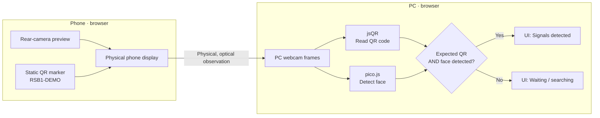

# Camera KYC — Cross-device camera verification prototype

**ResearchSpace / Profile B** is an experimental, browser-based computer-vision prototype exploring how a phone's physical screen might serve as an additional observable signal during a video-verification flow.

[**Live demo**](https://researchspace.ru/) · **English** · [Русский](README.ru.md)

> [!IMPORTANT]
> This is a **proof of concept, not a production-ready KYC, identity verification, or deepfake-detection system**. A positive result only means that the PC camera detected the expected demonstration QR value and a face somewhere in its video frame. It does **not** establish that the face is on the phone's screen, that the phone is trusted, or that the signals belong to the same authenticated session.

## What it demonstrates

The same static web page is opened independently on **two devices**:

1. **Phone:** displays its rear-camera live preview with a QR marker overlaid on the screen.
2. **PC:** uses its webcam to observe the physical phone screen (and the surrounding scene).
3. **PC-side JavaScript:** searches the webcam frames for the expected QR value using **jsQR** and for faces using **pico.js**.
4. **UI:** shows detection indicators and reports **“Signals detected”** if both signals are present.

There is **no phone-to-PC signaling channel**, no shared session handshake, and no backend verification service in the current version. The observation happens through the PC webcam.

## Architecture



**Important distinction:** the two detectors evaluate the PC webcam image independently. The current code does **not** test whether the detected face lies inside the phone's screen, whether the QR and face are spatially related, or whether the phone belongs to a trusted user.

## Try the demo

1. On a **PC**, open [researchspace.ru](https://researchspace.ru/) and choose **“Веб-камера ПК”** (PC webcam).
2. Allow access to the PC webcam.
3. On a **phone**, open the same URL and choose **“Телефон”** (Phone).
4. Allow the phone to use its camera.
5. Aim the phone's camera at the person, then hold the **phone screen toward the PC webcam** so that the PC can see the QR marker and a face in its frame.
6. Watch the detection statuses in the PC interface.

The hosted demo's interface is currently **in Russian**. This repository README is the English-language overview; the website and its language are unchanged.

If the camera is unavailable or permission is denied, the interface may enter an explicitly labeled **presentation fallback**. A successful-looking fallback result is **simulated**, not evidence of a completed real-world verification.

### Running it locally

```bash
git clone https://github.com/xLagerFeuer/deepfake-cv-test.git
cd deepfake-cv-test
python3 -m http.server 8000
```

Open `http://localhost:8000` in a browser on the same computer. For the two-device scenario, use the HTTPS-hosted demo (or another secure origin accessible from both devices), because browser camera APIs require a secure context. The page loads the face and QR libraries, and the face cascade, from external URLs.

## Implementation

| Part | Current implementation |
| --- | --- |
| Application | Single static `index.html` file; HTML, CSS, and JavaScript |
| PC camera | `navigator.mediaDevices.getUserMedia()` |
| Phone camera | `getUserMedia()`, preferring `facingMode: environment` |
| Face detector | [pico.js](https://github.com/nenadmarkus/picojs), running in the PC browser |
| QR decoder | [jsQR](https://github.com/cozmo/jsQR), running in the PC browser |
| Demo QR payload | `RSB1-DEMO` (fixed, not a session-issued challenge) |
| Detection result | Expected QR text **AND** a face detected in the PC's camera frame |
| Video processing | Browser-side; no application backend receives camera frames for CV processing |
| Camera-unavailable behavior | Presentation fallback, including simulated status transitions |

**What “Signals detected” means:** the PC-side code has found both indicators. It is a **UI/detection state**, not a security assertion, KYC pass, liveness proof, or identity match.

## Project structure

```text
.
├── README.md       # English overview (default on GitHub)
├── README.ru.md    # Original Russian documentation
├── index.html      # Entire deployed interface and browser-side logic
└── CNAME           # Custom-domain configuration: researchspace.ru
```

The website is served from `index.html`. This documentation does not change its behavior.

## Intended research direction

**Profile B** explores whether a previously authenticated or trusted phone can contribute an additional, physically observable factor to a video-verification process. The hypothesis is that coordinating several independently observable signals in one physical scene could raise an attacker's cost compared with a single video stream.

This repository is a minimal **computer-vision and UX feasibility prototype**, **not an evaluation demonstrating increased attack resistance**.

A more complete design would need, among other things:

- Server-issued, single-use, session-bound challenges and expiration.
- Cryptographic device/session association and device attestation.
- Reliable detection of phone and screen boundaries.
- Geometric checks linking the QR marker, displayed face, and physical screen.
- Active liveness or spatial challenges, including phone movement.
- Anti-replay protections, policy checks, and a verifiable audit trail.
- Real security evaluation with relevant benign and adversarial cases.

Until those controls exist and are evaluated, this prototype should not be used to make real identity-verification or anti-deepfake decisions.

## Languages

- **English (default):** `README.md`
- **Русский:** [README.ru.md](README.ru.md)

The [live demo](https://researchspace.ru/) and its Russian UI are maintained separately from the English GitHub documentation.
